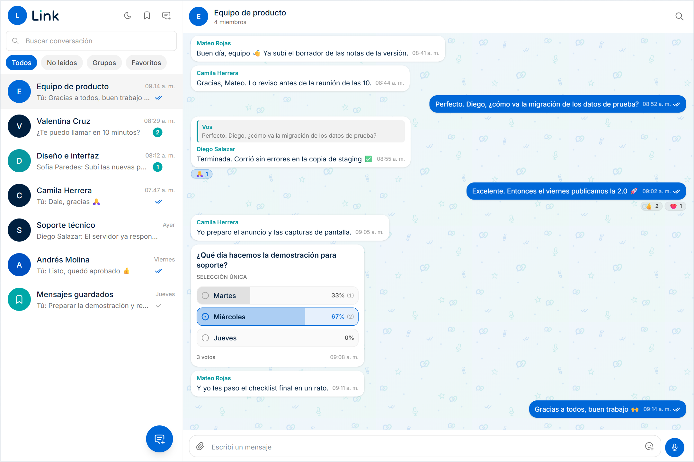

<p align="center">
  
</p>

<h1 align="center">LINK</h1>

<p align="center">
  Chat interno para equipos y organizaciones, pensado para instalarse en infraestructura propia.
</p>

<p align="center">
  <a href="#funcionalidades">Funcionalidades</a> ·
  <a href="#inicio-rápido-con-docker">Instalación</a> ·
  <a href="#desarrollo-local-sin-docker">Desarrollo</a> ·
  <a href="#variables-de-entorno">Configuración</a> ·
  <a href="#autenticación">Autenticación</a> ·
  <a href="#contribuir-y-seguridad">Contribuir</a>
</p>

<p align="center">
  
  <br>
  <sub>Captura con datos de demostración.</sub>
</p>

Monorepo con un backend en Express + Socket.IO + Prisma (PostgreSQL) y un frontend en Next.js.

> **Autenticación:** LINK funciona con cuentas propias (modo local, sin dependencias externas) o
> delegando el login en un sistema de identidad externo, con un proveedor de autenticación que se
> instala como plugin. Se elige en el `.env`; ver [Autenticación](#autenticación).

## Funcionalidades

- Conversaciones privadas, grupos y "mensajes guardados" (chat con uno mismo), en tiempo real.
- Reacciones, menciones con `@`, búsqueda dentro del chat, borradores, reenvío y selección
  múltiple de mensajes y conversaciones.
- Adjuntos (archivos, imágenes, notas de voz, fotos desde la cámara) con almacenamiento en disco
  o en un servicio compatible con S3, incluida la subida por partes de archivos grandes.
- Encuestas en grupos, compartir contactos y GIFs/stickers vía GIPHY (deshabilitado por defecto,
  ver [Requisitos de GIPHY](backend/src/modules/giphy/README.md#requisitos-de-giphy)).
- Llamadas y videollamadas 1 a 1 (WebRTC).
- Notificaciones push (Web Push) y PWA instalable.
- Panel de administración: configuración global, almacenamiento, usuarios (en modo local, alta de
  cuentas, contraseñas y política de sesión) y registro de auditoría.
- Interfaz en español e inglés, con tema claro y oscuro.

## Requisitos

Depende de cómo se instale (ver [Inicio rápido con Docker](#inicio-rápido-con-docker) y
[Desarrollo local](#desarrollo-local-sin-docker)):

| | Con Docker | Sin Docker (desarrollo) |
|---|---|---|
| **Git** | Sí | Sí |
| **Docker** con Docker Compose | Sí | No (opcional, para tener un PostgreSQL de prueba) |
| **Node.js** 24 (recomendado) o 22.12 o superior, con npm (la versión está fijada en `.nvmrc`) | Solo para `npm run setup`, que también corre [dentro de un contenedor](#sin-nodejs-instalado) | Sí |
| **PostgreSQL** (probado con la 17) | Lo incluye `docker-compose.yml` | Sí, propio o en un contenedor |

Opcional en los dos casos: un servicio compatible con S3 (SeaweedFS, MinIO, AWS S3…) para el
almacenamiento de archivos.

## Inicio rápido con Docker

La forma más simple de probar LINK o de instalarlo en un servidor: un solo `docker compose`
levanta PostgreSQL, el backend y el frontend. Las migraciones de base de datos se aplican solas al
arrancar el backend.

1. **Clonar el repositorio.**

   ```bash
   git clone https://github.com/anderlfrias/link.git
   cd link
   ```

2. **Generar la configuración.** Crea el `.env` con la contraseña de PostgreSQL, las claves de las
   notificaciones push y los secretos ya generados: no hay que copiar ni editar nada a mano. (Qué
   hace en detalle: [Qué hace `npm run setup`](#qué-hace-npm-run-setup). Sin Node.js instalado:
   [Sin Node.js instalado](#sin-nodejs-instalado).)

   ```bash
   npm run setup
   ```

3. **Levantar LINK.** La primera vez construye las imágenes y tarda unos minutos.

   ```bash
   docker compose up -d --build
   ```

4. **Crear el primer admin**, con el correo propio en lugar del de ejemplo. Es para el modo por
   defecto, con cuentas propias; con un proveedor de autenticación externo no aplica (ver
   [Con un proveedor de autenticación externo](#con-un-proveedor-de-autenticación-externo)).

   ```bash
   docker compose exec backend npm run auth:admin -- create-admin --email tu-correo@example.com
   ```

   El comando muestra una contraseña temporal **una sola vez**: copiarla antes de seguir.

5. **Entrar.** Abrir <http://localhost:3000>, iniciar sesión con ese correo y la contraseña
   temporal, y elegir una contraseña nueva (de 12 caracteres o más).

Listo: el frontend queda en <http://localhost:3000> y la API en <http://localhost:4000> (Socket.IO
en la misma URL). Desde el panel de administración, el admin crea las cuentas del resto del equipo
y ajusta la configuración funcional. Si algo no anda, ver [Si algo falla](#si-algo-falla).

### Qué hace `npm run setup`

Crea `.env` a partir de `.env.example` y genera lo que hace falta para arrancar:

| Variable | Qué es |
|---|---|
| `POSTGRES_PASSWORD` | Contraseña de PostgreSQL. |
| `SESSION_JWT_SECRET` | Firma las sesiones de LINK, con cualquier proveedor de autenticación. |
| `FILE_URL_SIGNING_SECRET` | Firma las URLs de descarga de archivos. |
| `VAPID_PUBLIC_KEY`, `VAPID_PRIVATE_KEY` | Par de claves de las notificaciones push (Web Push). |

No necesita `npm ci`, nunca pisa un valor que ya esté en el archivo (solo completa lo que está
vacío, así que se puede volver a correr sin riesgo) y no imprime ningún secreto, solo los nombres
de las variables que completó. Opciones, que se pasan después de `--` (por ejemplo,
`npm run setup -- --dev`):

| Opción | Efecto |
|---|---|
| `--vapid-subject mailto:equipo@example.org` | Reemplaza el contacto de ejemplo de las notificaciones push (un `mailto:` o una URL `https://`). |
| `--dev` | Prepara los archivos para correr sin Docker (ver [Desarrollo local](#desarrollo-local-sin-docker)). |
| `--help` | Muestra la ayuda. |

### Sin Node.js instalado

El mismo script corre dentro de un contenedor:

```bash
docker run --rm -v "$PWD":/work -w /work node:24-bookworm-slim node scripts/setup.js
```

(En PowerShell, `${PWD}` en lugar de `"$PWD"`. En Linux, agregar `--user "$(id -u):$(id -g)"`: sin
eso, el `.env` queda a nombre de root y `docker compose` no puede leerlo.)

### Con un proveedor de autenticación externo

Si la instalación delega el login en un sistema de identidad externo en lugar de usar cuentas
propias (ver [Autenticación](#autenticación)), definir `AUTH_PROVIDER_MODULE` y las variables del
proveedor en el `.env` antes de levantar (paso 3). El paso 4 no aplica: las cuentas y sus roles
(por ejemplo `admin`) vienen del proveedor. `SESSION_JWT_SECRET`, que el script genera, se usa con
cualquier proveedor.

### Si algo falla

| Síntoma | Qué hacer |
|---|---|
| `docker compose` no se conecta con Docker (`failed to connect to the docker API`, `Cannot connect to the Docker daemon`) | Docker no está iniciado: abrir Docker Desktop (o iniciar el servicio `docker` en Linux) y repetir. |
| `docker compose` dice `Falta POSTGRES_PASSWORD…` o `Falta VAPID_…` | No hay `.env` o está incompleto. Correr `npm run setup` en la raíz del repo. |
| `npm run setup` dice que falta `.env.example` | El checkout está incompleto (por ejemplo, se copió la carpeta sin los archivos ocultos). Volver a clonar el repositorio. |
| `npm run setup` avisa que `POSTGRES_PASSWORD` sigue en `change-me` | El `.env` ya existía (por ejemplo, copiado a mano) y el script no cambia solo una contraseña existente. Si todavía no se levantó LINK, borrar ese valor del `.env` y volver a correr el script. Si ya se levantó, no cambiarla: el volumen de PostgreSQL conserva la original. |
| El backend no arranca o se reinicia una y otra vez | Mirar `docker compose logs backend`. Causas comunes: un `.env` incompleto o con claves VAPID inválidas, o una `POSTGRES_PASSWORD` cambiada después del primer arranque (el volumen `postgres-data` conserva la contraseña original). Volver al valor original o, si no hay datos que conservar, `docker compose down -v` y levantar de nuevo (**borra los datos**). |
| El puerto 3000 o el 4000 ya está en uso | Cambiar `FRONTEND_PORT` o `BACKEND_PORT` en `.env`, actualizar `PUBLIC_API_URL`, `PUBLIC_SOCKET_URL` y `CORS_ORIGIN` con los puertos nuevos y volver a correr `docker compose up -d --build` (las URLs se embeben en el build del frontend). |
| La interfaz carga pero no deja iniciar sesión (en la consola del navegador aparece un error de CORS) | `CORS_ORIGIN` tiene que ser el origen exacto con el que se abre el frontend: `http://localhost:3000` no equivale a `http://127.0.0.1:3000` ni a la IP de la máquina. Además, `PUBLIC_API_URL` y `PUBLIC_SOCKET_URL` tienen que ser alcanzables desde el navegador. Corregirlos en `.env` y reconstruir con `docker compose up -d --build`. |
| Se perdió la contraseña temporal del admin | `docker compose exec backend npm run auth:admin -- reset-password --email tu-correo@example.com` genera otra (también sirve si el único admin olvidó la suya). |

### Notas

- Las URLs con las que el navegador llega a la API (`PUBLIC_API_URL`, `PUBLIC_SOCKET_URL`) se
  embeben en el build del frontend. Si se cambian los puertos o se publica detrás de un dominio,
  hay que actualizarlas en `.env` y reconstruir con `docker compose build frontend`.
- `CORS_ORIGIN` tiene que ser el origen con el que se abre el frontend (por defecto
  `http://localhost:3000`). Detrás de un proxy inverso, ajustar también `TRUST_PROXY` (ver
  [SECURITY.md](SECURITY.md#reverse-proxy-e-ip-del-cliente)).
- **Imágenes publicadas.** Cada versión (tag `vX.Y.Z`) publica en GHCR `ghcr.io/<dueño>/link-backend:X.Y.Z` y
  `link-frontend:X.Y.Z`, así que con Docker se puede actualizar cambiando el número de versión, sin
  reconstruir el backend. La imagen del backend es la base para agregar un proveedor de autenticación
  ([guía](docs/auth-providers.md)). La del frontend sale con las URLs de `localhost` (se embeben en el build):
  detrás de un dominio hay que reconstruirla con las propias, como se explica arriba.
- Los archivos subidos quedan en el volumen `uploads`, y la base de datos en `postgres-data`.
- Ver logs: `docker compose logs -f backend`. Bajar todo: `docker compose down`. Bajar y
  **borrar los datos**: `docker compose down -v`.
- **Actualizar.** `git pull` y `docker compose up -d --build`: el backend aplica las migraciones al
  arrancar. Antes de actualizar una instalación existente, hacer un backup de la base (ver
  [Base de datos y migraciones](#base-de-datos-y-migraciones)). El procedimiento completo está en
  [VERSIONING.md](VERSIONING.md#paso-7-actualizar-una-instalación).

## Desarrollo local (sin Docker)

Para modificar el código. Hace falta Node.js y un PostgreSQL (ver [Requisitos](#requisitos)).

1. **Clonar el repositorio e instalar las dependencias.** El `postinstall` del backend genera el
   cliente de Prisma:

   ```bash
   git clone https://github.com/anderlfrias/link.git
   cd link
   npm ci
   ```

2. **Tener un PostgreSQL disponible.** Por ejemplo, con Docker:

   ```bash
   docker run -d --name link-postgres -e POSTGRES_USER=link -e POSTGRES_PASSWORD=link -e POSTGRES_DB=link -p 5432:5432 postgres:17-alpine
   ```

3. **Generar la configuración:**

   ```bash
   npm run setup -- --dev
   ```

   Crea `backend/.env` y `frontend/.env.local` a partir de sus `.env.example`, y genera en el del
   backend las claves VAPID y los secretos. El `DATABASE_URL` de ejemplo ya apunta al contenedor
   del paso 2: con otro servidor, ajustarlo en `backend/.env`.

4. **Aplicar las migraciones:**

   ```bash
   npm run db:migrate
   ```

5. **Crear el primer admin** (modo local), con el correo propio:

   ```bash
   npm run auth:admin:dev --workspace=backend -- create-admin --email tu-correo@example.com
   ```

   Muestra una contraseña temporal **una sola vez**: copiarla.

6. **Levantar backend (puerto 4000) y frontend (puerto 3000) juntos:**

   ```bash
   npm run dev
   ```

   Abrir <http://localhost:3000> e iniciar sesión con ese correo y la contraseña temporal.

### Tests y build

```bash
npm test                                    # tests de backend y frontend (Vitest)
npm run test:coverage --workspace=backend   # con cobertura
npm run build                               # build de backend (tsc) y frontend (next build)
```

## Variables de entorno

Cada archivo `.env.example` documenta sus variables en detalle. `npm run setup` crea el archivo real
a partir de cada uno (ver [Inicio rápido con Docker](#inicio-rápido-con-docker)) y genera los secretos:

| Archivo | Para qué |
|---|---|
| [`.env.example`](.env.example) | `docker compose` |
| [`backend/.env.example`](backend/.env.example) | Backend sin Docker (`backend/.env`) |
| [`frontend/.env.example`](frontend/.env.example) | Frontend sin Docker (`frontend/.env.local`) |

Las más importantes del backend:

| Variable | Obligatoria | Descripción |
|---|---|---|
| `DATABASE_URL` | sí | Conexión a PostgreSQL. |
| `AUTH_PROVIDER_MODULE` | no | Ruta absoluta al módulo de un proveedor de autenticación externo ([guía](docs/auth-providers.md)). Sin definir, cuentas locales. |
| `SESSION_JWT_SECRET` | sí | Firma las sesiones de LINK, en todos los modos. 32 caracteres o más; cambiarla cierra todas las sesiones. (`LOCAL_AUTH_JWT_SECRET`, su nombre anterior, se sigue aceptando con un aviso.) |
| `VAPID_PUBLIC_KEY`, `VAPID_PRIVATE_KEY`, `VAPID_SUBJECT` | sí | Notificaciones push. Con claves inválidas el backend no arranca. |
| `CORS_ORIGIN` | en producción | Origen(es) del frontend, separados por coma. Con `NODE_ENV=production` es obligatoria (sin ella el backend no arranca); `*` acepta cualquier origen a propósito. Fuera de producción, sin definir acepta cualquier origen. |
| `TRUST_PROXY` | no | Proxies delante del backend: `1` (por defecto), `2`, o `false` si el backend está expuesto directo. Ver [SECURITY.md](SECURITY.md#reverse-proxy-e-ip-del-cliente). |
| `TRUST_CF_CONNECTING_IP` | no | `true` solo si todo el tráfico entra por Cloudflare. Por defecto `false`. |
| `FILE_URL_SIGNING_SECRET` | recomendada | Firma de las URLs de archivos. Sin definir, usa `SESSION_JWT_SECRET`. |
| `GIPHY_API_KEY` | no | GIFs/stickers vía GIPHY. Sin definir quedan deshabilitados. Antes de activarlos, ver [Requisitos de GIPHY](backend/src/modules/giphy/README.md#requisitos-de-giphy). |
| `STORAGE_WRITE_PROVIDER`, `S3_*` | no | Almacenamiento en disco (`LOCAL`, por defecto) o S3. |
| `LOG_LEVEL`, `LOG_PRETTY` | no | Nivel y formato del log (JSON por defecto). |

El frontend solo necesita `NEXT_PUBLIC_API_URL` y `NEXT_PUBLIC_SOCKET_URL`, que se embeben al
hacer el build.

La configuración funcional (límites de subida, permisos de grupos, retención de mensajes,
auditoría, etc.) **no** va en el `.env`: se edita desde el panel de administración y se guarda en
la base.

## Autenticación

El modo se deduce de las variables de entorno del backend:

- **Proveedor externo** (`AUTH_PROVIDER_MODULE` definida): el login se delega en un sistema de identidad
  externo, a través de un proveedor de autenticación. LINK le pide que valide las credenciales **solo
  en el login**, crea o actualiza el perfil local del usuario, guarda sus roles (por ejemplo `admin`) y
  emite su propia sesión: de ahí en más el token del sistema externo no se acepta en ningún lado. Cómo
  escribir, instalar y probar un proveedor: [`docs/auth-providers.md`](docs/auth-providers.md).
- **Local** (sin `AUTH_PROVIDER_MODULE`): las cuentas y sus contraseñas viven
  en la base de LINK. Se inicia sesión con el correo o el nombre de usuario.
  - El primer admin se crea por terminal con `npm run auth:admin -- create-admin --email <correo>`
    (con Docker, `docker compose exec backend npm run auth:admin -- …`; sin compilar,
    `auth:admin:dev`). La contraseña temporal se muestra **una sola vez** y hay que cambiarla al
    entrar. `reset-password --email <correo>` restablece la de cualquier cuenta, por ejemplo si el
    único admin olvidó la suya.
  - Desde el panel de administración, un admin crea y edita cuentas, restablece contraseñas,
    desbloquea y desactiva cuentas, y define la duración de la sesión y la política de contraseñas
    (largo mínimo, composición, vencimiento, historial y bloqueo por intentos fallidos).
  - Detalles en [`backend/src/modules/auth/README.md`](backend/src/modules/auth/README.md) y en
    [`docs/design/LOCAL_AUTH_PLAN.md`](docs/design/LOCAL_AUTH_PLAN.md).

En los dos modos un admin puede desactivar el acceso de una cuenta al chat. Si el módulo del proveedor
no se encuentra o su configuración es inválida, el backend no arranca (en lugar de caer por error en las
cuentas locales). Para pasar una instalación existente de un modo al otro, ver
[LOCAL_AUTH_PLAN.md §10](docs/design/LOCAL_AUTH_PLAN.md#10-cambiar-de-modo-en-una-instalación-existente).

## Base de datos y migraciones

El esquema vive en [`backend/prisma/schema.prisma`](backend/prisma/schema.prisma) y se aplica con
migraciones de Prisma (`backend/prisma/migrations/`):

| Comando | Uso |
|---|---|
| `npm run db:migrate` | Aplica las migraciones pendientes (instalaciones nuevas, despliegues). |
| `npm run db:migrate:dev` | Desarrollo: crea una migración nueva a partir de cambios en `schema.prisma`. |
| `npm run db:baseline` | Solo una vez, en instalaciones creadas antes de las migraciones (ver abajo). |

No hace falta ningún *seed*: la fila de configuración global se crea sola en el primer arranque.
Con un proveedor externo, los usuarios se crean al iniciar sesión.

**Instalaciones existentes creadas con `prisma db push`.** Antes de usar migraciones hay que
marcar la migración inicial como ya aplicada, sin ejecutarla ni tocar datos:

```bash
cd backend
npx prisma migrate diff --from-config-datasource --to-schema prisma/schema.prisma   # debe decir "No difference detected"
npm run db:baseline
npm run db:migrate                                                                  # "No pending migrations to apply"
```

Si `migrate diff` muestra diferencias, la base no coincide con el esquema actual: revisarlas
antes de seguir. Hacer un backup antes de cualquiera de estos pasos.

**Backup antes de actualizar.** Algunas migraciones cambian datos y no se pueden deshacer. La
`20261008120000_purge_deleted_message_content` borra de forma permanente el texto, las encuestas y
la relación con los archivos de los mensajes que ya estaban eliminados (los archivos en sí no se
borran: los libera la limpieza de archivos huérfanos, si está activada). Antes de actualizar una
instalación existente, hacer un backup de la base:

```bash
# Con Docker (usuario y base por defecto del docker-compose.yml)
docker compose exec -T postgres pg_dump -U link -Fc link > link-backup.dump

# Sin Docker
pg_dump --format=custom --file=link-backup.dump "$DATABASE_URL"
```

## Producción sin Docker

```bash
npm ci
NEXT_PUBLIC_API_URL=https://api.example.com/api NEXT_PUBLIC_SOCKET_URL=https://api.example.com npm run build
npm run db:migrate
pm2 start ecosystem.config.js   # o: npm start
```

- El backend tiene que correr como **una sola instancia**: Socket.IO no tiene un adapter
  compartido (Redis), así que con varias instancias los eventos no llegarían a todos los clientes.
- `ecosystem.config.js` arranca el backend con `NODE_ENV=production`, así que `CORS_ORIGIN` es
  obligatoria en `backend/.env`.
- Si hay un proxy inverso delante, definir `TRUST_PROXY` (y `TRUST_CF_CONNECTING_IP` si el tráfico
  entra por Cloudflare) según [SECURITY.md](SECURITY.md#reverse-proxy-e-ip-del-cliente).

## Almacenamiento S3

Por defecto los archivos se guardan en disco (`backend/uploads`, o el volumen `uploads` con
Docker). Con ese almacenamiento, el tamaño máximo de un archivo es **32 MB**, sin importar lo que
se configure en el panel de administración: la subida por partes de archivos grandes (hasta 2 GB
por defecto) necesita S3. Para usar un servicio compatible con S3:

- Definir `STORAGE_WRITE_PROVIDER=S3` y las variables `S3_*`.
- El navegador sube y descarga **directo** contra `S3_ENDPOINT` con URLs firmadas, así que esa URL
  tiene que ser alcanzable igual desde el backend y desde el navegador. Por ejemplo, un dominio
  propio, no un nombre interno de Docker.
- El bucket necesita CORS que permita `GET`, `PUT` y `HEAD` desde el origen del frontend y que
  exponga el header `ETag`.

Los archivos que ya están en disco se pueden migrar a S3 desde el panel de administración. El
diseño completo está en [`docs/design/LARGE_FILES_PLAN.md`](docs/design/LARGE_FILES_PLAN.md).

## Estructura

```
.
├── backend/                 # API Express + Socket.IO + Prisma
│   ├── prisma/              # schema.prisma y migraciones
│   ├── src/modules/         # un módulo por dominio, cada uno con su README
│   ├── src/socket/          # gateway y registro de eventos en tiempo real
│   ├── src/workers/         # tareas periódicas (retención, limpieza, migración de archivos)
│   └── API.md               # referencia de la API para el frontend
├── frontend/                # Next.js (App Router)
│   └── src/features/        # una carpeta por funcionalidad (api, components, hooks, types)
├── docs/design/             # documentos de diseño de cada iniciativa
├── scripts/                 # npm run setup, sincronizar la versión y generar el sonido de notificación
├── docker-compose.yml
└── ecosystem.config.js      # PM2 (producción sin Docker)
```

Documentación técnica:

- [`docs/ARCHITECTURE.md`](docs/ARCHITECTURE.md): arquitectura global del sistema, flujos de datos, seguridad y limitaciones operativas.
- [`backend/README.md`](backend/README.md): arquitectura del backend y modelo de datos relacional.
- [`backend/API.md`](backend/API.md): referencia de la API RESTful y de los eventos de Socket.IO.
- Los `README.md` de cada módulo en `backend/src/modules/`.
- [`docs/auth-providers.md`](docs/auth-providers.md): guía para crear e integrar proveedores de autenticación externos como plugins.
- [`docs/design/`](docs/design/): documentos de diseño técnico (logging y auditoría, archivos grandes, testing, autenticación local).

## Estado del proyecto y Roadmap

Líneas de trabajo planificadas:

- **Escalabilidad horizontal**: adaptador distribuido para Socket.IO (Redis Streams o Pub/Sub) y store compartido de rate limiting para permitir múltiples instancias del backend en clúster.
- **Subida por partes en disco**: soporte para subida chunked multipart directamente sobre disco local sin depender de S3 para archivos superiores a 32 MB.
- **Herramientas de calidad de código**: configuración e integración de linter y formateador homogéneos (ESLint/Prettier o Biome) en el monorepo y la CI.
- **Proveedores de identidad estándar**: soporte directo para OpenID Connect (OIDC) y SAML 2.0 como plugins de autenticación.
- **Llamadas grupales**: servidor de medios centralizado (SFU) para audio y video en conferencias multipersona.

Limitaciones operativas y de seguridad conocidas (el detalle está en
[SECURITY.md](SECURITY.md#limitaciones-conocidas)):

- El backend debe ejecutarse como **una sola instancia** (los límites de frecuencia y Socket.IO residen en memoria).
- Los archivos mayores a 32 MB requieren almacenamiento S3 configurado.
- El directorio de usuarios muestra el correo de todas las cuentas activas, y los avatares se descargan sin autenticación previa.
- Los mensajes no cuentan con cifrado de extremo a extremo (E2EE): viajan cifrados en tránsito y se almacenan en claro en la base de datos para auditoría y moderación.
- Las notificaciones push llevan el texto del mensaje y permanecen activas hasta el cierre de sesión o revocación.
- Las URLs firmadas de descarga de archivos tienen una validez de 1 hora y son portadoras.
- La validación por contenido binario real cubre los formatos más comunes; los formatos de texto se validan por el tipo declarado.
- El token de sesión se almacena en `localStorage` del navegador.

## Contribuir y seguridad

- [CONTRIBUTING.md](CONTRIBUTING.md): cómo preparar el entorno, convenciones y reglas de tests.
- [SECURITY.md](SECURITY.md): cómo reportar vulnerabilidades y recomendaciones de despliegue.
- [CHANGELOG.md](CHANGELOG.md) y [VERSIONING.md](VERSIONING.md): historial y proceso de versiones.

## Licencia

Copyright © 2026 Anderson Frias.

LINK es software libre bajo la [GNU Affero General Public License v3.0](LICENSE), solo esa versión
(`AGPL-3.0-only`). En la práctica, se puede usar, estudiar, modificar y redistribuir. Quien
distribuya una versión modificada, o la ofrezca a otras personas a través de una red (por ejemplo,
una instalación de LINK con cambios propios que usa un equipo), tiene que ofrecerles el código
fuente de esa versión bajo la misma licencia. El texto de [LICENSE](LICENSE) es el que vale: este
resumen no lo reemplaza.

El contenido de terceros (diseños de avatares, tipografías, íconos y dependencias con licencias
a tener en cuenta) está en [THIRD_PARTY_NOTICES.md](THIRD_PARTY_NOTICES.md).

El nombre LINK, el logo y los íconos son assets de marca y se tratan aparte del código: no quedan
cubiertos por la AGPL. La lista de archivos está en
[THIRD_PARTY_NOTICES.md](THIRD_PARTY_NOTICES.md#marca-nombre-logo-e-íconos).
